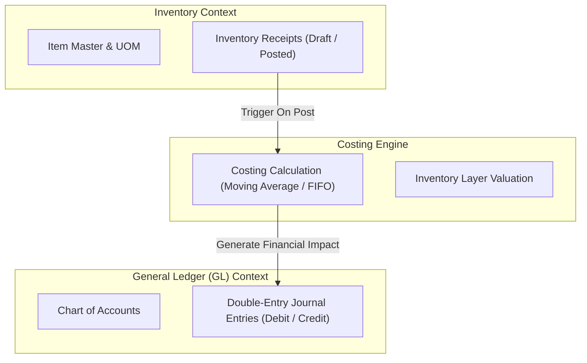

# Architecture & System Design Document

**System**: Inventory Receipts with Costing and GL Posting  
**Document Status**: Phase 01 Foundation Baseline

---

## 1. System Overview & Problem Statement

This system automates the procurement receiving cycle in an enterprise environment. When inventory arrives at a warehouse, the system records the physical receipt, calculates inventory valuation according to configured costing policies, and immediately posts balanced double-entry accounting records into the General Ledger (GL).

### Primary Business Goals

1. **Accurate Inventory Valuation**: Maintain real-time stock counts and precise monetary valuation upon receipt.
2. **Immediate Financial Transparency**: Ensure every physical inventory receipt automatically creates a balanced General Ledger journal entry.
3. **Audit Integrity**: Provide end-to-end traceability between physical warehouse receipts and financial ledgers.

---

## 2. Architectural Style & Monorepo Strategy

The application is structured as a **Modular Monolith** organized in an isolated multi-package repository using **pnpm Workspaces**:

```
[ Frontend SPA (React + Vite) ]
             |
             | HTTP / REST (JSON)
             v
[ Backend API (NestJS + TypeScript) ]
             |
             | Prisma ORM (Type-Safe Query Engine)
             v
[ PostgreSQL Relational Database (ACID Engine) ]
```

### Key Architectural Invariants

- **Physical Boundary Isolation**: Backend and frontend maintain strictly separated `package.json` manifests, TypeScript configs, and build targets.
- **Contract-First Communication**: Frontend communicates exclusively via structured REST API endpoints versioned under `/api/v1/`.
- **Zero Secret Exposure**: Server credentials and database connection strings exist solely in the backend runtime and are blocked from client bundles.

---

## 3. Bounded Contexts (Domain Boundaries)

The architecture establishes three discrete bounded contexts:



1. **Inventory Management Context**: Manages items, warehouses, and receipt documents.
2. **Costing Engine Context**: Responsible for calculating unit costs and inventory asset values upon receipt.
3. **General Ledger Context**: Manages the Chart of Accounts, fiscal periods, and double-entry balancing rules.

---

## 4. Financial & Domain Invariants

1. **Double-Entry Balance Guarantee**: Every journal entry generated from a receipt MUST satisfy:
   $$\sum \text{Debit Amounts} = \sum \text{Credit Amounts}$$
2. **Financial Immutability**: Once a receipt is transitioned to `POSTED`, neither the receipt quantities nor the corresponding journal entries may be edited or deleted. Corrections require offsetting reversal transactions.
3. **Atomic State Transition**: Receipt status update, inventory balance increment, and GL journal entry creation must execute within a single ACID database transaction.

---

## 5. Phase 01 Architecture Decisions Record (ADR)

| Decision ID | Topic              | Selected Choice          | Rationale                                                                                                     |
| ----------- | ------------------ | ------------------------ | ------------------------------------------------------------------------------------------------------------- |
| **ADR-001** | Package Management | `pnpm` Workspaces        | Native monorepo workspace isolation, zero-hoisting collisions, fast symlink caching.                          |
| **ADR-002** | Backend Framework  | NestJS 11 + Express      | Strong modularity, dependency injection, declarative validation pipes, and enterprise lifecycle management.   |
| **ADR-003** | Database & ORM     | PostgreSQL 16 + Prisma 6 | ACID guarantees for double-entry bookkeeping, strict type-safe schema modeling, and robust migration tooling. |
| **ADR-004** | Port Mapping       | Host port `5434` for DB  | Bypasses local host port `5432` collision while keeping standard container port `5432`.                       |
| **ADR-005** | Frontend Framework | React 19 + Vite 6        | High-speed ESM build pipeline, strict TypeScript typing, and lightweight runtime overhead.                    |
