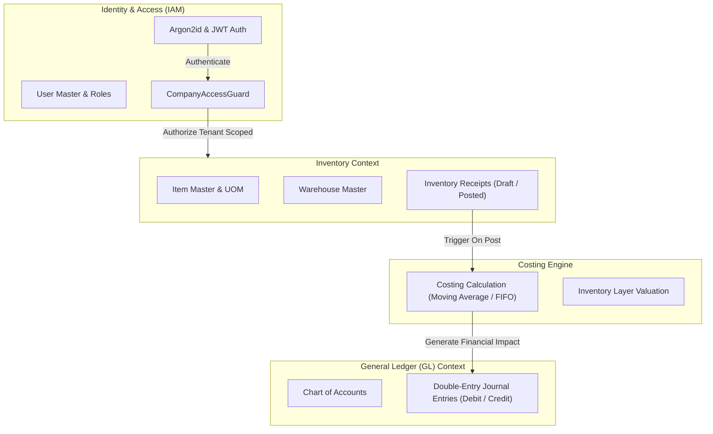

# Architecture & System Design Document

**System**: Inventory Receipts with Costing and GL Posting  
**Document Status**: Phase 03 Security & Multi-Tenancy Baseline

---

## 1. System Overview & Problem Statement

This system automates the procurement receiving cycle in an enterprise environment. When inventory arrives at a warehouse, the system records the physical receipt, calculates inventory valuation according to configured costing policies, and immediately posts balanced double-entry accounting records into the General Ledger (GL).

### Primary Business Goals

1. **Accurate Inventory Valuation**: Maintain real-time stock counts and precise monetary valuation upon receipt.
2. **Immediate Financial Transparency**: Ensure every physical inventory receipt automatically creates a balanced General Ledger journal entry.
3. **Audit Integrity & Multi-Tenancy**: Provide end-to-end traceability between physical warehouse receipts and financial ledgers with strict tenant isolation.

---

## 2. Architectural Style & Monorepo Strategy

The application is structured as a **Modular Monolith** organized in an isolated multi-package repository using **pnpm Workspaces**:

```
[ Frontend SPA (React + Vite) ]
             |
             | HTTP / REST (JSON) + Bearer JWT + X-Correlation-ID
             v
[ Backend API (NestJS + TypeScript) ]
             |
             +---> Security Layer: Helmet + Centralized AllExceptionsFilter
             +---> Auth Guard: JwtAuthGuard + DB Status Validation
             +---> Tenant Isolation: CompanyAccessGuard (IDOR Prevention)
             +---> RBAC Guard: RolesGuard (SUPER_ADMIN, ADMIN, etc.)
             |
             v Prisma ORM (Type-Safe Query Engine)
[ PostgreSQL Relational Database (ACID Engine) ]
```

---

## 3. Security, Authentication & Multi-Tenancy Architecture

### 3.1 Authentication Flow (Phase 03)

- **Password Security**: Passwords are never stored as plaintext. User credentials are encrypted using **Argon2id** (`@node-rs/argon2`), providing state-of-the-art resistance against GPU-accelerated brute force attacks.
- **Stateless Tokens with Live State Verification**: Authentication issues signed JWT tokens containing `{ sub, email, companyId, role }`. On every protected request, `JwtStrategy` revalidates with PostgreSQL that both the `User` and `Company` remain `isActive: true`. If a user or tenant is disabled, existing tokens are immediately revoked.
- **Generic Error Responses**: Login failures return unified, generic error responses (`Invalid credentials: check company code, email, or password`) to prevent account or tenant enumeration.

### 3.2 Multi-Company Data Isolation & IDOR Prevention

- **Trusted Server-Side Context**: Client-supplied company IDs, user IDs, or roles in request bodies/params are never trusted blindly.
- **`CompanyAccessGuard`**: Inspects route parameters (e.g. `:companyId`). If a user from Company A attempts to access or query resources belonging to Company B, the guard immediately rejects the request with **403 Forbidden**.
- **Tenant-Scoped Data Queries**: All service operations explicitly filter database queries by the verified `req.user.companyId`.
- **Platform `SUPER_ADMIN` Access**: Cross-tenant administrative operations are restricted to explicit, audited system administrators.

### 3.3 Observability & Security Hardening

- **HTTP Security Headers**: Enforced via `helmet` (blocking clickjacking, MIME sniffing, and enforcing secure referrer policies).
- **Request Correlation**: `CorrelationIdMiddleware` assigns a unique `X-Correlation-ID` to every HTTP request and attaches it to response headers and log traces.
- **Centralized Exception Sanitization**: `AllExceptionsFilter` intercepts all thrown errors. In production, database internals, table structures, and stack traces are stripped, returning sanitized client error contracts.

---

## 4. Bounded Contexts (Domain Boundaries)



---

## 5. Financial & Domain Invariants

1. **Double-Entry Balance Guarantee**: Every journal entry generated from a receipt MUST satisfy:
   $$\sum \text{Debit Amounts} = \sum \text{Credit Amounts}$$
2. **Financial Immutability**: Once a receipt is transitioned to `POSTED`, neither the receipt quantities nor the corresponding journal entries may be edited or deleted. Corrections require offsetting reversal transactions.
3. **Atomic State Transition**: Receipt status update, inventory balance increment, and GL journal entry creation must execute within a single ACID database transaction.

---

## 6. Architecture Decisions Record (ADR)

| Decision ID | Topic               | Selected Choice              | Rationale                                                                                            |
| ----------- | ------------------- | ---------------------------- | ---------------------------------------------------------------------------------------------------- |
| **ADR-001** | Package Management  | `pnpm` Workspaces            | Native monorepo workspace isolation, zero-hoisting collisions, fast symlink caching.                 |
| **ADR-002** | Backend Framework   | NestJS 11 + Express          | Strong modularity, dependency injection, declarative validation pipes, enterprise lifecycle.         |
| **ADR-003** | Database & ORM      | PostgreSQL 16 + Prisma 6     | ACID guarantees for double-entry bookkeeping, strict type-safe schema modeling.                      |
| **ADR-004** | Port Mapping        | Host port `5434` for DB      | Bypasses local host port `5432` collision while keeping standard container port `5432`.              |
| **ADR-005** | Frontend Framework  | React 19 + Vite 6            | High-speed ESM build pipeline, strict TypeScript typing, lightweight runtime overhead.               |
| **ADR-006** | Password Hashing    | Argon2id (`@node-rs/argon2`) | Native Rust prebuilt N-API library; standard against memory/GPU brute force attacks.                 |
| **ADR-007** | Multi-Tenancy Guard | `CompanyAccessGuard`         | Server-side enforcement of tenant boundary on route parameters; eliminates IDOR risks.               |
| **ADR-008** | Error Sanitization  | `AllExceptionsFilter`        | Guarantees internal database stack traces or Prisma internals are never exposed to clients.          |
| **ADR-009** | Concurrency Control | `SELECT ... FOR UPDATE`      | Pessimistic locking with deterministic balance ordering prevents race conditions and deadlocks.      |
| **ADR-010** | Event Delivery      | Transactional Outbox Pattern | Outbox events created in the exact same transaction as receipt posting/voiding guarantees atomicity. |
| **ADR-011** | Outbox Worker       | `FOR UPDATE SKIP LOCKED`     | Enables concurrent, non-overlapping worker claims across multiple application instances.             |

---

## 7. Audit Trail Architecture

The audit system provides tamper-proof, append-only operational observability:

- **Atomicity**: When an audit event accompanies a committed business transaction (such as `RECEIPT_POSTED` or `RECEIPT_VOIDED`), it is written within the exact same database transaction client. If the transaction rolls back, no orphaned success audit record remains.
- **Tenant Isolation**: Audit logs are strictly partitioned by `companyId`. Queries via `GET /api/v1/audit-events` filter by `req.user.companyId`.
- **Immutability**: Audit records have no `UPDATE` or `DELETE` endpoints.
- **Sensitive Data Cleansing**: Passwords, secrets, tokens, and authorization headers are recursively redacted prior to persistence.
- **End-to-End Tracing**: Attaches HTTP `x-correlation-id` to audit logs for distributed log correlation.

---

## 8. Transactional Outbox Architecture & Processing

To guarantee reliable event delivery without dual-write inconsistencies, the system uses the **Transactional Outbox Pattern**:

```
[ POST /api/v1/receipts/:id/post ]
               │
               ▼ Single PostgreSQL ACID Transaction
   ┌────────────────────────────────────────────────────────┐
   │ 1. Lock Receipt (`SELECT FOR UPDATE`)                  │
   │ 2. Check Open Accounting Period                        │
   │ 3. Lock & Update Stock Balances (Moving Average Cost)  │
   │ 4. Insert Append-Only Stock Movements                  │
   │ 5. Insert Balanced GL Journal Entry (Debit/Credit)     │
   │ 6. Update Receipt status -> POSTED                     │
   │ 7. Insert AuditEvent (RECEIPT_POSTED)                  │
   │ 8. Insert OutboxEvent (RECEIPT_POSTED, status=PENDING) │
   └────────────────────────────────────────────────────────┘
               │ Commit Transaction
               ▼
[ Background OutboxProcessor Worker ]
   ┌────────────────────────────────────────────────────────┐
   │ 1. Recover stale PROCESSING leases older than timeout  │
   │ 2. Claim batch with `FOR UPDATE SKIP LOCKED`           │
   │ 3. Update status -> PROCESSING, lockedAt, lockedBy     │
   └────────────────────────────────────────────────────────┘
               │ Execute Handler Outside DB Transaction
               ▼
   Success? ───► status = PROCESSED, processedAt = NOW()
   Transient Error? ──► status = PENDING, nextRetryAt (exponential backoff + jitter)
   Permanent Error? ──► status = FAILED, lastError (redacted)
```

- **At-Least-Once Delivery**: Downstream consumers are expected to be idempotent using the event's unique `id`.
- **Worker Concurrency**: Multiple worker processes safely process events concurrently without locking conflicts using PostgreSQL's `SKIP LOCKED`.
- **Resilience**: Crashed worker claims are automatically reclaimed via lease expiration recovery (`recoverStaleLeases`).
- **Controlled Replay**: Administrators can inspect failed events and queue them for controlled reprocessing via `POST /api/v1/outbox/:id/replay`.
