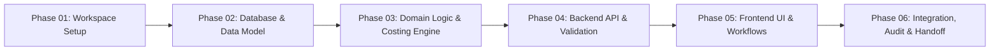

# Implementation Plan — Inventory Receipts with Costing & GL Posting

This document outlines the phased development roadmap for the **Inventory Receipts with Costing and GL Posting** ERP solution. In strict compliance with Phase 01 constraints, subsequent phases are planned here without premature implementation.

---

## Phase Overview

---

## Phase 01: Professional Project Workspace Setup (Current Phase)

- **Objective**: Establish monorepo workspace, environment validation, Dockerized PostgreSQL, Prisma baseline, quality gates, and project documentation.
- **Deliverables**: Root workspace, `backend/` NestJS workspace, `frontend/` React/Vite workspace, `docker-compose.yml`, CI workflow, and technical health probe.
- **Exit Criteria**: All linters, type checks, tests, and builds succeed across root, backend, and frontend without any business code or domain tables.

---

## Phase 02: Database Schema & Prisma Data Model

- **Objective**: Design the relational schema and Prisma models capturing inventory, receipts, costing metadata, and General Ledger (GL) double-entry bookkeeping.
- **Key Entities**:
  - `Item`: SKU, description, unit of measure, valuation method (FIFO / Moving Average / Standard Cost), asset account, COGS account.
  - `ReceiptHeader`: Receipt number, vendor, status (DRAFT, POSTED, CANCELLED), receipt date, total amount.
  - `ReceiptLine`: Item reference, received quantity, unit cost, line subtotal, tax, inventory location/warehouse.
  - `Account`: Chart of Accounts (Asset, Liability, Equity, Revenue, Expense) with code and description.
  - `JournalEntry`: Transaction date, reference ID, source type (RECEIPT, ADJUSTMENT), posting timestamp.
  - `JournalLine`: Entry reference, account reference, debit amount, credit amount.
- **Constraints & Invariants**:
  - Check constraint enforcing non-negative quantity and positive unit cost.
  - Journal entry balancing constraint ($\sum \text{Debit} = \sum \text{Credit}$).
  - Immutable audit trail for posted receipts.

---

## Phase 03: Core Domain Services & Costing Engine

- **Objective**: Implement pure domain business logic and costing calculations isolated from transport protocols.
- **Key Domain Services**:
  - `CostingEngine`: Calculates inventory valuation upon receipt according to configured costing method (e.g. weighted moving average or FIFO layers).
  - `PostingEngine`: Generates balanced double-entry accounting records:
    - **Debit**: Inventory Asset Account (increase in asset value).
    - **Credit**: Accounts Payable / Inventory Received Not Billed (Accrual).
  - `ReceiptProcessingService`: Enforces state transitions (Draft $\to$ Posted) atomically inside a PostgreSQL ACID transaction.

---

## Phase 04: Backend REST API & Transactional Controller Layer

- **Objective**: Expose authenticated, validated REST endpoints for receipts, inventory lookup, and ledger journal inquiries.
- **Key Endpoints**:
  - `POST /api/v1/receipts`: Create draft receipt with line item validation.
  - `POST /api/v1/receipts/:id/post`: Atomic posting trigger executing costing calculation and GL journal generation.
  - `GET /api/v1/receipts/:id`: Retrieve receipt details with associated journal entries.
  - `GET /api/v1/accounts`: Chart of accounts inquiry.
  - `GET /api/v1/inventory/items`: Item catalogue with current valuation and on-hand quantities.

---

## Phase 05: Frontend User Interface & Enterprise Workflows

- **Objective**: Deliver a clean, professional React UI for warehouse clerks and accountants.
- **Key Modules**:
  - Receipt Entry Form: Dynamic line-item grid, auto-calculating totals, vendor selection.
  - Posting Confirmation Modal: Summary preview showing expected debits and credits before committing.
  - Audit Trail View: Drill-down from receipt to corresponding general ledger journal entry.
  - Inventory Overview: Real-time stock valuation and unit cost display.

---

## Phase 06: End-to-End Integration, Reconciliation & Verification

- **Objective**: Validate the full operational cycle from receipt entry to financial statement impact.
- **Verification Suites**:
  - Financial reconciliation test: Guaranteeing zero trial balance discrepancies across all test transactions.
  - Concurrency test: Preventing race conditions on moving average unit cost calculations during simultaneous receipt submissions.
  - Documentation and user manual finalization.
