# Implementation Plan — Inventory Receipts with Costing & GL Posting

This document outlines the phased development roadmap for the **Inventory Receipts with Costing and GL Posting** ERP solution.

---

## Phase Overview

```mermaid
flowchart LR
  P1[Phase 01: Workspace Setup] --> P2[Phase 02: Database & Data Model]
  P2 --> P3[Phase 03: Security & Multi-Tenancy]
  P3 --> P4[Phase 04: Receipts Drafts API]
  P4 --> P5[Phase 05: Inventory Ledger & Costing Engine]
  P5 --> P6[Phase 06: Accounting Foundation & Chart of Accounts]
  P6 --> P7[Phase 07: Posting Engine & GL Posting]
  P7 --> P8[Phase 08: Frontend UI & Workflows]
  P8 --> P9[Phase 09: Integration & Reconciliation]

  style P1 fill:#dcfce7,stroke:#16a34a,stroke-width:2px
  style P2 fill:#dcfce7,stroke:#16a34a,stroke-width:2px
  style P3 fill:#dcfce7,stroke:#16a34a,stroke-width:2px
  style P4 fill:#dcfce7,stroke:#16a34a,stroke-width:2px
  style P5 fill:#dcfce7,stroke:#16a34a,stroke-width:2px
  style P6 fill:#dcfce7,stroke:#16a34a,stroke-width:2px
  style P7 fill:#e0f2fe,stroke:#0284c7,stroke-width:2px
```

---

## Phase 01: Professional Project Workspace Setup (COMPLETED)

- **Objective**: Establish monorepo workspace, environment validation, Dockerized PostgreSQL, Prisma baseline, quality gates, and project documentation.
- **Deliverables**: Root workspace, `backend/` NestJS workspace, `frontend/` React/Vite workspace, `docker-compose.yml`, CI workflow, and technical health probe.
- **Exit Status**: 100% verified across linters, strict type checks, unit tests, E2E tests, and production builds.

---

## Phase 02: Database Foundation & Prisma Data Model (COMPLETED)

- **Objective**: Implement the relational database foundation, Prisma schema, migration workflow, and deterministic development seed.
- **Implemented Entities**:
  - `Company`: Multi-tenant organization boundary.
  - `User`: Enterprise user identity and role-based permissions (`ADMIN`, `ACCOUNTANT`, `WAREHOUSE_MANAGER`, `CLERK`).
  - `Warehouse`: Multi-site inventory locations.
  - `Supplier`: Procurement counterparties with tax ID and payment terms.
  - `Account`: Chart of Accounts (`ASSET`, `LIABILITY`, `EQUITY`, `REVENUE`, `EXPENSE`).
  - `AccountingPeriod`: Fiscal period governance (`OPEN`, `CLOSED`).
  - `Item`: Product master with valuation method and links to asset, COGS, and expense accounts.
  - `StockBalance`: Real-time on-hand quantity, total value, and average cost with optimistic concurrency versioning.
  - `Receipt` & `ReceiptLine`: Inventory receipt documents and line items with `Decimal(19, 4)` and `Decimal(18, 4)` precision.
  - `StockMovement`: Append-only inventory transaction ledger.
  - `JournalEntry` & `JournalLine`: Balanced double-entry financial accounting records.
  - Supporting Infrastructure: `AuditEvent`, `IdempotencyRecord`, `OutboxEvent`.
- **Migration & Seed**:
  - Applied migration `20261022084335_init_database_foundation`.
  - Created idempotent seed script (`backend/prisma/seed.ts` via `pnpm db:seed`).
- **Exit Status**: Fully verified in PostgreSQL 16 container on port 5434; zero business workflows leaked into this phase.

---

## Phase 03: Senior Backend Engineering, Security & Multi-Tenancy (COMPLETED)

- **Objective**: Implement authentication, authorization (RBAC), multi-tenant data isolation, security headers, correlation tracking, and centralized exception sanitization.
- **Implemented Features**:
  - **Argon2id Hashing**: Cryptographically robust password hashing via `@node-rs/argon2`.
  - **Auth Feature Module**: `POST /api/v1/auth/login` (tenant-scoped credentials, generic failure message) and `GET /api/v1/auth/me`.
  - **Token Management**: JWT access tokens signed with HMAC-SHA256 (`@nestjs/jwt@^11.0.0`), revalidating active user and company status on every request.
  - **RBAC Authorization**: `@Roles()` decorator + `RolesGuard` supporting `SUPER_ADMIN`, `ADMIN`, `ACCOUNTANT`, `CLERK`, and `VIEWER`.
  - **Multi-Tenant Guarding**: `CompanyAccessGuard` intercepting `:companyId` route parameters and preventing cross-tenant data access (HTTP 403).
  - **Companies Feature Module**: Tenant-scoped endpoints for current company details, warehouses, and catalog items.
  - **Operational Hardening**: Helmet HTTP security headers, CORS origin verification, global `ValidationPipe`, correlation IDs (`X-Correlation-ID`), and production-safe `AllExceptionsFilter`.
  - **Automated Test Coverage**: 4 unit test suites (22/22 passing) and 2 real PostgreSQL E2E test suites (17/17 passing).
- **Exit Status**: 100% verified against live PostgreSQL container. Zero receipt workflows or frontend pages leaked into this phase.

---

## Phase 04: Inventory Receipts Drafts & Management API (COMPLETED)

- **Objective**: Implement complete backend API for creating, reading, listing, updating, and managing draft inventory receipts and lines.
- **Implemented Features**:
  - **Draft Receipt Creation**: `POST /api/v1/receipts` creating header and 1+ lines atomically in a database transaction (`$transaction`), server-calculated totals, auto-generated or custom validated receipt number.
  - **List Receipts & Pagination**: `GET /api/v1/receipts` supporting `page`, `limit`, `status`, `warehouseId`, `supplierId`, `startDate`, `endDate`, `search`, deterministic tie-breaker sorting, and pagination metadata.
  - **Get Receipt by ID**: `GET /api/v1/receipts/:id` retrieving full document, sequential lines, item master details, and relation summaries.
  - **Update Draft Header**: `PATCH /api/v1/receipts/:id` updating warehouse, supplier, date, receipt number, notes on draft receipts only.
  - **Atomic Lines Reconciliation**: `PUT/PATCH /api/v1/receipts/:id/lines` replacing/reconciling all lines atomically, re-indexing lines sequentially, and recalculating totals.
  - **Fine-Grained Line Endpoints**: `POST /:id/lines`, `PATCH /:id/lines/:lineId`, and `DELETE /:id/lines/:lineId`.
  - **Financial Decimal Precision**: Implemented `DecimalMath` using `Prisma.Decimal` and `ROUND_HALF_UP` to 4 decimal places for quantities, unit costs, and monetary lines.
  - **Strict Validation Rules**: `@IsPositiveDecimal()` for quantities ($>0$), `@IsNonNegativeDecimal()` for unit costs ($\ge 0$), minimum 1 line requirement, no deletion of the only line.
  - **Status & Ownership Invariants**: Updates and deletions prohibited for non-draft receipts (`POSTED`, `CANCELLED`); mass-assignment of status or company ownership blocked.
  - **Multi-Tenant Security & IDOR Defense**: Strict company boundary validation across warehouse, supplier, items, and receipts (HTTP 403 on cross-tenant access).
  - **Automated Test Coverage**: 6 unit test suites (49/49 passing) and 3 real PostgreSQL E2E test suites (37/37 passing).
- **Exit Status**: 100% verified against live PostgreSQL container. Zero costing or GL posting logic leaked into this phase.

---

## Phase 05: Inventory Ledger, Stock Balances & Weighted Average Costing (COMPLETED)

- **Objective**: Implement pure domain business logic, moving weighted-average costing engine, concurrency-safe stock balance mutations, and append-only inventory ledger.
- **Implemented Features**:
  - `CostingEngineService`:
    - Pure domain service calculating inbound moving weighted-average costs with `Prisma.Decimal` and `ROUND_HALF_UP` to 4 decimal places.
    - Zero-stock / initial intake assigns incoming unit cost directly without division-by-zero.
    - Inbound receipts at `0.0000` unit cost dilute moving average cost correctly.
    - Outbound stock issues relieved strictly at current moving average cost.
    - Zero residual penny invariant: full stock depletion ($Q_{\text{out}} = Q_{\text{onhand}}$) strictly resets `totalValue` and `averageCost` to `0.0000`.
  - `StockBalanceService`:
    - PostgreSQL atomic upsert `INSERT ... ON CONFLICT ("companyId", "warehouseId", "itemId") DO NOTHING` eliminates initial-balance race condition.
    - Explicit row-level lock `SELECT ... FOR UPDATE` prevents lost updates and concurrency anomalies.
    - Read-only balance reconciliation audit comparing balance snapshot against aggregated ledger movements (`reconcileBalance`).
  - `InventoryLedgerService`:
    - Append-only transactional ledger recording all movements (`StockMovement`) with balance snapshot (`quantityAfter`, `totalValueAfter`).
    - Negative stock prevention via `InsufficientStockException` (HTTP 400 Bad Request).
    - Compensating movement reversal workflow (`reverseMovement`) with duplicate prevention.
    - Concurrency retry wrapper (`withRetry`) with bounded exponential backoff and jitter for transient serialization (`40001`), deadlock (`40P01`), and write conflict (`P2034`) errors.
    - Deterministic multi-row lock ordering by `itemId: 'asc'` to prevent circular wait deadlocks.
  - `InventoryController`:
    - `GET /api/v1/inventory/balances` with pagination, sorting, search, warehouse, and item filters.
    - `GET /api/v1/inventory/balances/:warehouseId/:itemId` single balance lookup.
    - `GET /api/v1/inventory/movements` queryable audit log with date ranges and movement types.
    - `GET /api/v1/inventory/reconcile/:warehouseId/:itemId` read-only synchronization verification.
  - **Automated Test Coverage**:
    - 3 new unit test suites: `costing-engine.service.spec.ts` (10/10), `stock-balance.service.spec.ts` (5/5), `inventory-ledger.service.spec.ts` (7/7).
    - 1 new integration E2E suite: `test/inventory-ledger-and-costing.e2e-spec.ts` (15/15 tests passing on real PostgreSQL container, including concurrent parallel race tests).
- **Exit Status**: 100% verified against live PostgreSQL container. Zero GL postings or receipt post transitions leaked into this phase.

---

## Phase 06: Accounting Foundation, Chart of Accounts & Accounting Periods (COMPLETED)

- **Objective**: Establish the accounting foundation, chart of accounts tree hierarchy, accounting period controls, inventory account configuration, and strict double-entry validation engine.
- **Implemented Features**:
  - **Prisma Schema Enhancements**:
    - `Account.parentId String?` with self-referencing tree relation (`parent` / `children` with `onDelete: Restrict`).
    - `Company.grnClearingAccountId String?` referencing `Account` (`onDelete: Restrict`).
    - Migration `20261022123745_add_account_hierarchy_and_company_clearing_account` generated and applied.
  - **Chart of Accounts Service & Controller** (`/api/v1/accounts`):
    - Multi-tenant CRUD operations for accounts with unique code per tenant (`@@unique([companyId, code])`).
    - Tree integrity validation: parent existence check, tenant boundary check, self-parenting prevention, cycle detection algorithm.
    - Safe deletion rules: blocked with HTTP 409 if referenced by child accounts, journal lines, item asset accounts, or company clearing config.
  - **Accounting Periods Service & Controller** (`/api/v1/accounting-periods`):
    - Period creation and management with strict calendar boundaries (`startDate <= endDate`).
    - Non-overlapping invariant: tenant-scoped overlap query blocks date range collisions with HTTP 409 Conflict.
    - Period lifecycle: open/close state transitions.
    - Reusable validation helpers: `getEligibleOpenPeriod(companyId, date, tx)` and `isDateInOpenPeriod`.
  - **Inventory Accounts Service & Controller** (`/api/v1/accounting/inventory-accounts`):
    - Company-level configuration for Goods Receipt Note (GRN) Clearing Account (`LIABILITY` classification, active, same tenant).
    - Reusable resolver `resolveReceiptAccounts(companyId, itemIds, tx)` resolving GRN clearing and item asset accounts (`ASSET` classification) in preparation for receipt posting.
  - **Pure Double-Entry Validation Engine** (`JournalValidatorService`):
    - Enforces minimum 2 lines per journal entry.
    - Exact mathematical balancing: $\sum \text{Debit} = \sum \text{Credit}$ calculated at 4 decimal places (`ROUND_HALF_UP`).
    - Enforces single-leg lines: each line must have either `debit > 0, credit = 0` OR `credit > 0, debit = 0`.
    - Zero-value lines (`debit = 0, credit = 0`) and negative values rejected with HTTP 400.
    - Active account check and open period check.
  - **Journal Entries Service & Controller** (`/api/v1/journal-entries`):
    - Draft creation endpoint (`POST /api/v1/journal-entries`) persisting validated draft entries with sequential line numbering.
    - Validate-only endpoint (`POST /api/v1/journal-entries/validate`) testing journal lines without database mutation.
    - Retrieval and query endpoints with tenant isolation and date/period filters.
  - **Automated Test Coverage**:
    - 5 unit test suites (40 tests passing): `accounts.service.spec.ts` (10/10), `accounting-periods.service.spec.ts` (6/6), `inventory-accounts.service.spec.ts` (7/7), `journal-validator.service.spec.ts` (14/14), `journal-entries.service.spec.ts` (3/3).
    - 1 new integration E2E suite: `test/accounting-foundation.e2e-spec.ts` (33/33 tests passing on live PostgreSQL container).
    - Total codebase test count: **202 automated tests passing with 100% green**.
- **Exit Status**: Fully verified in live PostgreSQL container; zero receipt posting orchestration or frontend UI leaked into this phase.

---

## Phase 07: Receipt Posting Orchestration & General Ledger Posting (NEXT PHASE)

- **Objective**: Implement atomic receipt posting orchestration (`DRAFT` $\to$ `POSTED`), automated double-entry GL journal generation, accounting period controls, and idempotency protection.
- **Key Deliverables to Implement**:
  - `PostingEngineService`:
    - Generates balanced double-entry General Ledger journal records:
      - **Debit**: Item Inventory Asset Account (`Item.assetAccountId`) for line valuation.
      - **Credit**: GRN Clearing Account (`Company.grnClearingAccountId`) for total receipt amount.
    - Strict validation invariant: $\sum \text{Debit} = \sum \text{Credit}$ (throws domain error if variance $\neq 0$).
  - `ReceiptPostingService`:
    - Orchestrates atomic state transition (`DRAFT` $\to$ `POSTED`) inside a PostgreSQL ACID transaction.
    - Atomically updates `StockBalance`, writes `StockMovement` records, generates `JournalEntry`, and updates `Receipt` status.
    - Enforces idempotency via `IdempotencyRecord`.
  - Accounting Period Verification:
    - Verifies that `receiptDate` falls within an open accounting period (`AccountingPeriod.status === OPEN`).
  - Endpoints:
    - `POST /api/v1/receipts/:id/post`: Atomic post endpoint with idempotency key support.
    - `POST /api/v1/receipts/:id/cancel`: Cancellation and reversing entry workflow.

---

## Phase 08: Frontend User Interface & Enterprise Workflows

- **Objective**: Deliver a clean, professional React UI for warehouse clerks and accountants.
- **Key Modules**:
  - Receipt Entry Form: Dynamic line-item grid, auto-calculating totals, vendor selection.
  - Posting Confirmation Modal: Summary preview showing expected debits and credits before committing.
  - Audit Trail View: Drill-down from receipt to corresponding general ledger journal entry.
  - Inventory Overview: Real-time stock valuation and unit cost display.

---

## Phase 09: End-to-End Integration, Reconciliation & Verification

- **Objective**: Validate the full operational cycle from receipt entry to financial statement impact.
- **Verification Suites**:
  - Financial reconciliation test: Guaranteeing zero trial balance discrepancies across all test transactions.
  - Concurrency test: Preventing race conditions on moving average unit cost calculations during simultaneous receipt submissions.
  - Documentation and user manual finalization.
