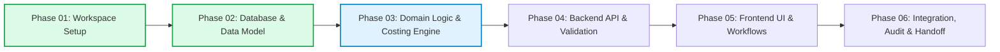

# Implementation Plan — Inventory Receipts with Costing & GL Posting

This document outlines the phased development roadmap for the **Inventory Receipts with Costing and GL Posting** ERP solution.

---

## Phase Overview

---

## Phase 01: Professional Project Workspace Setup (COMPLETED)

- **Objective**: Establish monorepo workspace, environment validation, Dockerized PostgreSQL, Prisma baseline, quality gates, and project documentation.
- **Deliverables**: Root workspace, `backend/` NestJS workspace, `frontend/` React/Vite workspace, `docker-compose.yml`, CI workflow, and technical health probe.
- **Exit Status**: 100% verified across linters, strict type checks, unit tests, E2E tests, and production builds.

---

## Phase 02: Database Foundation & Prisma Data Model (COMPLETED)

- **Objective**: Implement the relational database foundation, Prisma schema, migration workflow, and deterministic development seed.
- **Implemented Entities**:
  - `Company`: Multi-tenant organization boundary.
  - `User`: Enterprise user identity and role-based permissions (`ADMIN`, `ACCOUNTANT`, `WAREHOUSE_MANAGER`, `CLERK`).
  - `Warehouse`: Multi-site inventory locations.
  - `Supplier`: Procurement counterparties with tax ID and payment terms.
  - `Account`: Chart of Accounts (`ASSET`, `LIABILITY`, `EQUITY`, `REVENUE`, `EXPENSE`).
  - `AccountingPeriod`: Fiscal period governance (`OPEN`, `CLOSED`).
  - `Item`: Product master with valuation method and links to asset, COGS, and expense accounts.
  - `StockBalance`: Real-time on-hand quantity, total value, and average cost with optimistic concurrency versioning.
  - `Receipt` & `ReceiptLine`: Inventory receipt documents and line items with `Decimal(19, 4)` and `Decimal(18, 4)` precision.
  - `StockMovement`: Append-only inventory transaction ledger.
  - `JournalEntry` & `JournalLine`: Balanced double-entry financial accounting records.
  - Supporting Infrastructure: `AuditEvent`, `IdempotencyRecord`, `OutboxEvent`.
- **Migration & Seed**:
  - Applied migration `20261022084335_init_database_foundation`.
  - Created idempotent seed script (`backend/prisma/seed.ts` via `pnpm db:seed`).
- **Exit Status**: Fully verified in PostgreSQL 16 container on port 5434; zero business workflows leaked into this phase.

---

## Phase 03: Core Domain Services & Costing Engine (NEXT PHASE)

- **Objective**: Implement pure domain business logic, costing algorithms, and financial posting services isolated from transport controllers.
- **Key Domain Services to Implement**:
  - `CostingEngineService`:
    - Moving Weighted-Average calculation formula:
      $$\text{New Average Cost} = \frac{(\text{Current Qty} \times \text{Current Avg Cost}) + (\text{Received Qty} \times \text{Received Unit Cost})}{\text{Current Qty} + \text{Received Qty}}$$
    - Handling zero on-hand quantity division and standard cost fallback.
  - `PostingEngineService`:
    - Generates balanced double-entry General Ledger journal records:
      - **Debit**: Item Inventory Asset Account (`1200`) for total line valuation.
      - **Credit**: Inventory Received Not Invoiced Accrual (`2100`) for total receipt amount.
    - Strict validation invariant: $\sum \text{Debit} = \sum \text{Credit}$ (throws domain error if variance $\neq 0$).
  - `ReceiptPostingService`:
    - Orchestrates atomic state transition (`DRAFT` $\to$ `POSTED`) inside a PostgreSQL ACID transaction.
    - Atomically updates `StockBalance`, writes `StockMovement` records, generates `JournalEntry`, and updates `Receipt` status.
    - Enforces idempotency via `IdempotencyRecord`.

---

## Phase 04: Backend REST API & Transactional Controller Layer

- **Objective**: Expose authenticated, validated REST endpoints for receipts, inventory lookup, and ledger journal inquiries.
- **Key Endpoints**:
  - `POST /api/v1/receipts`: Create draft receipt with line item validation.
  - `POST /api/v1/receipts/:id/post`: Atomic posting trigger executing costing calculation and GL journal generation.
  - `GET /api/v1/receipts/:id`: Retrieve receipt details with associated journal entries.
  - `GET /api/v1/accounts`: Chart of accounts inquiry.
  - `GET /api/v1/inventory/items`: Item catalogue with current valuation and on-hand quantities.

---

## Phase 05: Frontend User Interface & Enterprise Workflows

- **Objective**: Deliver a clean, professional React UI for warehouse clerks and accountants.
- **Key Modules**:
  - Receipt Entry Form: Dynamic line-item grid, auto-calculating totals, vendor selection.
  - Posting Confirmation Modal: Summary preview showing expected debits and credits before committing.
  - Audit Trail View: Drill-down from receipt to corresponding general ledger journal entry.
  - Inventory Overview: Real-time stock valuation and unit cost display.

---

## Phase 06: End-to-End Integration, Reconciliation & Verification

- **Objective**: Validate the full operational cycle from receipt entry to financial statement impact.
- **Verification Suites**:
  - Financial reconciliation test: Guaranteeing zero trial balance discrepancies across all test transactions.
  - Concurrency test: Preventing race conditions on moving average unit cost calculations during simultaneous receipt submissions.
  - Documentation and user manual finalization.
