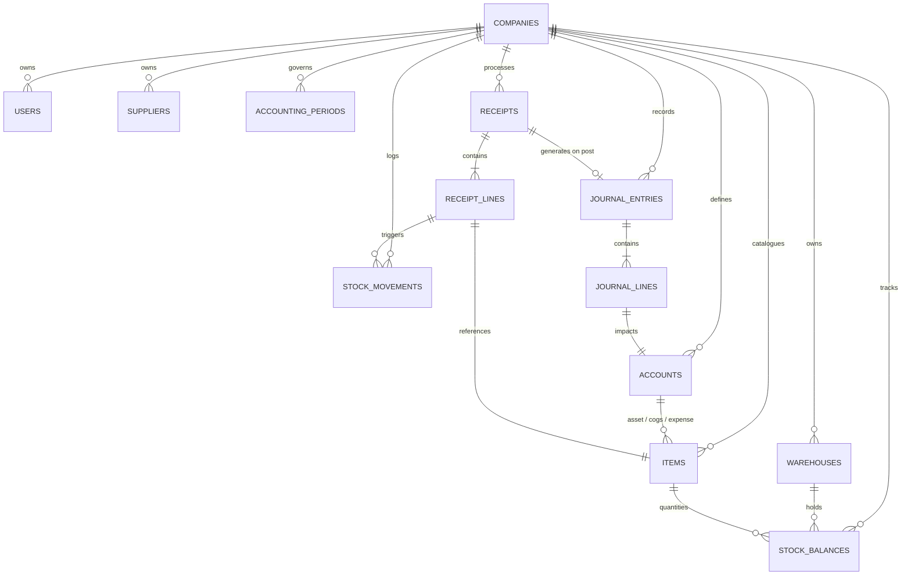
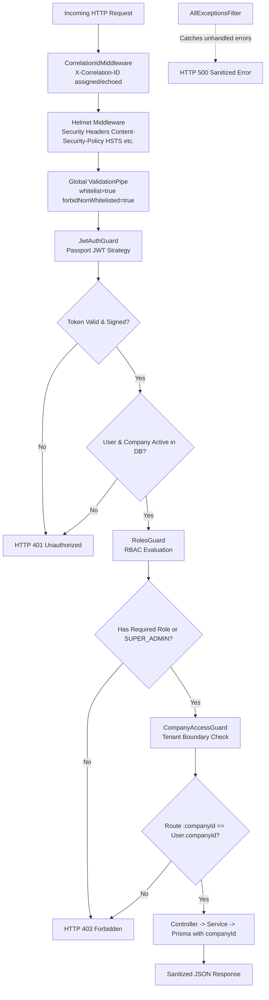

# Project Domain & Database Architecture Analysis

**Project**: Inventory Receipts with Costing and GL Posting  
**Phase**: Phase 03 — Senior Backend Engineering, Security & Multi-Tenancy  
**Author**: Senior Software Engineer & Software Architect

---

## 1. Executive Summary & Problem Domain

The core responsibility of an Enterprise Resource Planning (ERP) procurement and inventory subsystem is ensuring that the physical intake of materials is synchronized with financial accounting records without discrepancy or latency.

In classic accounting, when goods arrive at a warehouse:

1. Physical goods are verified against delivery notes.
2. The inventory asset value increases on the balance sheet.
3. A matching financial accrual (Goods Received Not Invoiced / GR-IR) is recognized in the General Ledger.
4. Unit costs are updated across inventory valuation layers.

Phase 02 established the relational schema, foreign key constraints, indexes, and precision standards necessary to enforce these rules at the database engine level.

Phase 03 establishes the security perimeter, authentication foundation, role-based access control (RBAC), multi-tenant isolation barriers, and API hardening required to operate this system securely in an enterprise multi-company environment.

---

## 2. Relational Schema Architecture

---

## 3. Entity-by-Entity Design Rationale

### 3.1 Tenant Root & Organization

- **`Company`**: Represents the tenant boundary. Every critical entity carries a `companyId` foreign key. Compound unique constraints (e.g. `[companyId, sku]`, `[companyId, code]`, `[companyId, receiptNumber]`) prevent cross-tenant key collisions while allowing independent numbering sequences per company.
- **`User`**: System actors with defined enterprise roles (`SUPER_ADMIN`, `ADMIN`, `ACCOUNTANT`, `CLERK`, `VIEWER`). Scoped per company via `@@unique([companyId, email])`.
- **`Warehouse`**: Physical storage locations where stock balances reside.
- **`Supplier`**: External procurement counterparties.

### 3.2 Inventory & Valuation Masters

- **`Item`**: Defines cataloged stock units. Carries mandatory links to:
  - `assetAccountId`: The balance sheet asset account (e.g. `1200 Inventory`).
  - `cogsAccountId`: The income statement expense account (e.g. `5000 COGS`).
  - `expenseAccountId`: An optional variance/shrinkage account (e.g. `5100 Variance`).
  - `valuationMethod`: `MOVING_AVERAGE`, `FIFO`, or `STANDARD_COST`.
- **`StockBalance`**: Materialized view of current stock status per item and warehouse:
  - `quantityOnHand`: Total available physical stock.
  - `totalValue`: Total monetary value of on-hand inventory.
  - `averageCost`: Real-time unit cost ($\frac{\text{totalValue}}{\text{quantityOnHand}}$).
  - `version`: Integer sequence incremented on every balance mutation for **optimistic concurrency control**.
- **`StockMovement`**: Append-only transactional ledger documenting every stock addition or deduction. Never updated or deleted; provides 100% forensic auditability.

### 3.3 Receipt Transactions

- **`Receipt`**: Transaction header recording receipt metadata, warehouse, supplier, receiving clerk, and lifecycle state (`DRAFT`, `POSTED`, `CANCELLED`).
  - `journalEntryId`: Optional 1-to-1 unique foreign key linking the posted receipt directly to its General Ledger journal entry.
- **`ReceiptLine`**: Line items specifying `quantityReceived`, `unitCost`, and calculated monetary lines.
  - `onDelete: Cascade` is permitted only from `ReceiptLine` to `Receipt` (in draft state), but application-level state machine strictly forbids deleting posted receipts.

### 3.4 General Ledger & Double-Entry Bookkeeping

- **`Account`**: Chart of Accounts defining financial classifications (`ASSET`, `LIABILITY`, `EQUITY`, `REVENUE`, `EXPENSE`) and normal balances (`DEBIT`, `CREDIT`).
- **`AccountingPeriod`**: Represents monthly or annual accounting windows. Prevents posting into closed fiscal periods.
- **`JournalEntry`**: Double-entry journal transaction header. Enforces balanced postings.
- **`JournalLine`**: Individual debit and credit legs of a transaction.

### 3.5 Enterprise Resiliency & Audit

- **`AuditEvent`**: Tracks who modified what, when, and from what IP address.
- **`IdempotencyRecord`**: Stores incoming client idempotency keys to ensure network retries do not execute double receipt postings or double stock increments.
- **`OutboxEvent`**: Implements the Transactional Outbox pattern to safely coordinate events with external message buses without distributed two-phase commits.

---

## 4. Decimal Precision & Financial Arithmetic Decisions

Floating-point arithmetic (`FLOAT`, `DOUBLE PRECISION`) is strictly forbidden for financial and ERP systems due to binary rounding inaccuracies (e.g. $0.1 + 0.2 \neq 0.3$).

| Data Attribute                                              | PostgreSQL Data Type | Digits (Total, Scale)    | Rationale                                                                                                                                                                                                      |
| ----------------------------------------------------------- | -------------------- | ------------------------ | -------------------------------------------------------------------------------------------------------------------------------------------------------------------------------------------------------------- |
| **Currency Amounts** (`totalAmount`, `debit`, `credit`)     | `DECIMAL(19, 4)`     | 15 integer, 4 fractional | International accounting standard supporting micro-currencies and multi-decimal tax splits while preventing rounding drift.                                                                                    |
| **Unit Costs** (`unitCost`, `averageCost`, `standardCost`)  | `DECIMAL(19, 4)`     | 15 integer, 4 fractional | Moving average calculations frequently yield fractional cents (e.g. \$12.3456 per unit). Rounding to 2 decimals during intermediate receipt processing creates massive valuation drift across high quantities. |
| **Stock Quantities** (`quantityReceived`, `quantityOnHand`) | `DECIMAL(18, 4)`     | 14 integer, 4 fractional | Supports fractional units of measure (e.g. 1,250.7500 KG or 14.5000 Liters) without integer overflow.                                                                                                          |

---

## 5. Referential Integrity & Deletion Invariants

1. **Destructive Cascade Elimination**:
   - Deleting an `Account`, `Item`, `Warehouse`, or `Supplier` with existing transaction lines or balances is blocked via `onDelete: Restrict`.
   - Once a receipt transitions to `POSTED`, neither the receipt header, line items, nor the corresponding journal entries can be deleted. Corrections must take the form of reversing transactions.
2. **Compound Uniqueness for Multitenancy**:
   - Entities guarantee intra-tenant uniqueness:
     - `@@unique([companyId, code])`
     - `@@unique([companyId, sku])`
     - `@@unique([companyId, receiptNumber])`
     - `@@unique([companyId, entryNumber])`
     - `@@unique([companyId, warehouseId, itemId])`
3. **Index Strategy**:
   - High-cardinality search paths (e.g. `[companyId, status, receiptDate]`) are indexed to ensure sub-millisecond query execution even under millions of receipt records.

---

## 6. Phase 03 Security Architecture & Multi-Tenant Isolation

### 6.1 Authentication & Security Pipeline

### 6.2 Password Security & Cryptography

- **Algorithm**: **Argon2id** (the winner of the Password Hashing Competition, resistant to both GPU and side-channel attacks) implemented via `@node-rs/argon2`.
- **Enumeration Prevention**: Login endpoint (`POST /api/v1/auth/login`) returns an identical, generic `HTTP 401: Invalid company, email, or password` message regardless of whether the company code, email, or password was incorrect.
- **Token Format**: Standard JSON Web Tokens (JWT) signed with HMAC-SHA256 (`JWT_SECRET`), containing minimal claims (`sub`, `email`, `role`, `companyId`).
- **Dynamic Revalidation**: Rather than trusting stale claims in the JWT indefinitely, every protected request verifies with the database that:
  1. The user account still exists.
  2. `user.isActive === true`.
  3. The user's tenant `company.isActive === true`.

### 6.3 Multi-Tenant Isolation Guarantees

In multi-tenant ERP architectures, data leakage between tenants is catastrophic. Multi-tenancy in this system is enforced across three distinct layers:

1. **Database Layer (Primary Invariant)**:
   - Every tenant-owned table carries a non-nullable `companyId` foreign key.
   - Compound indexes ensure uniqueness per tenant (e.g. `[companyId, code]`).
2. **Framework & Guard Layer (Boundary Invariant)**:
   - `CompanyAccessGuard` intercepts any route referencing `:companyId`. If `req.user.companyId !== params.companyId` (and the user is not `SUPER_ADMIN`), access is immediately denied with `HTTP 403 Forbidden`.
3. **Application & Query Layer (Data Invariant)**:
   - Application services explicitly scope all Prisma queries with `where: { companyId }`.
   - Never accept an unverified tenant identifier from client request bodies.
