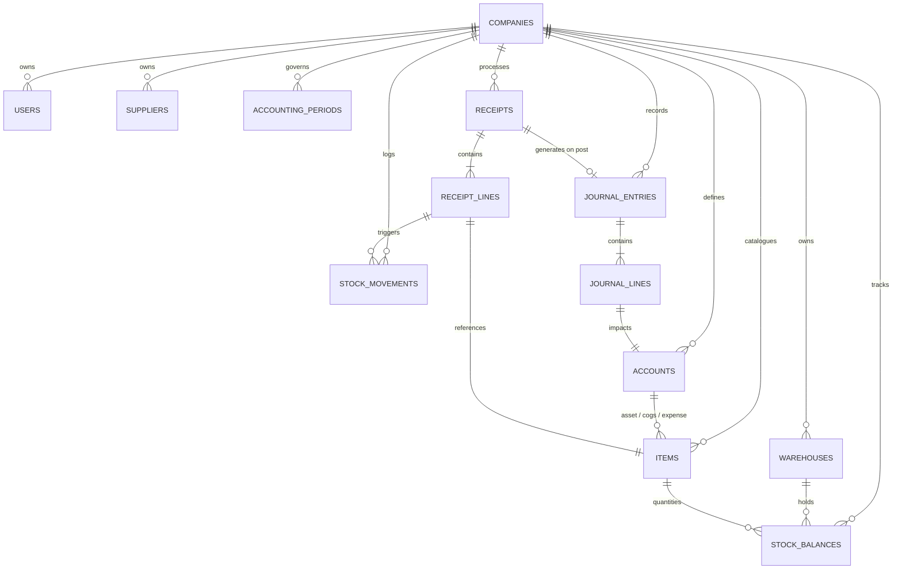
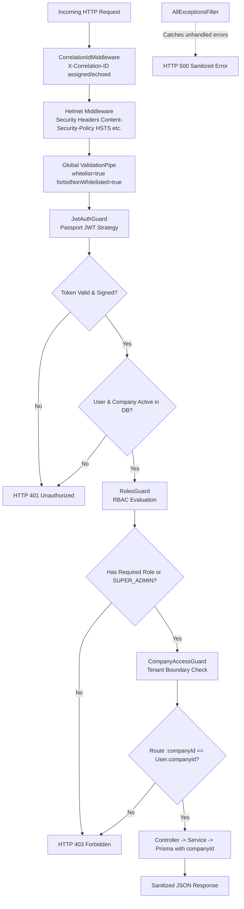
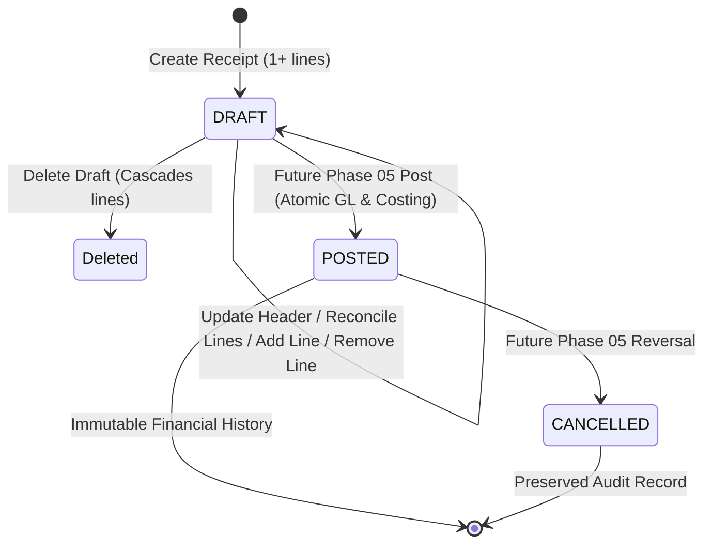
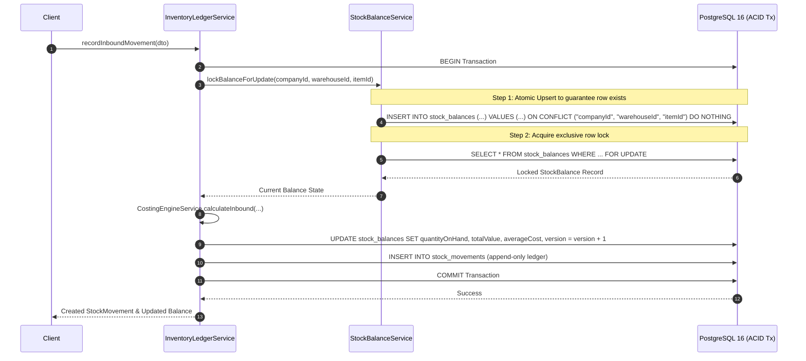
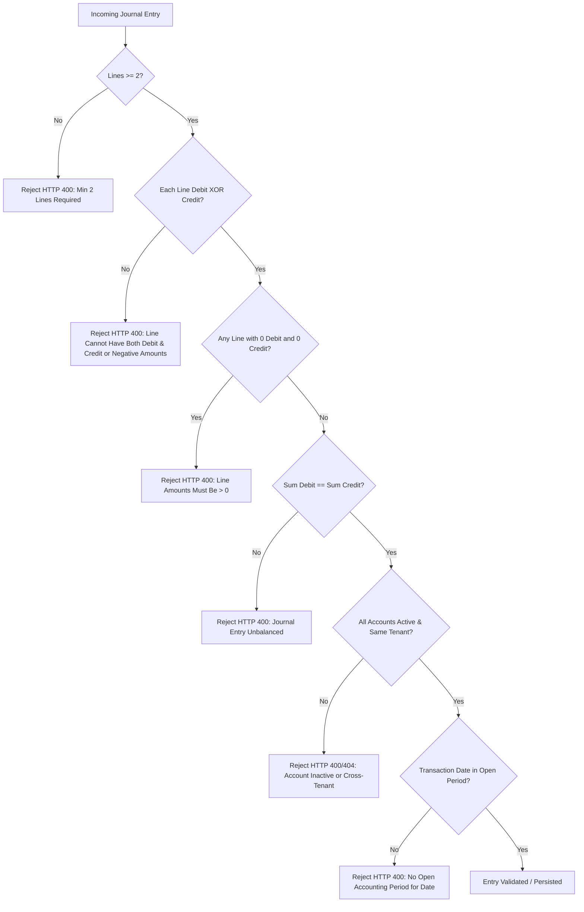
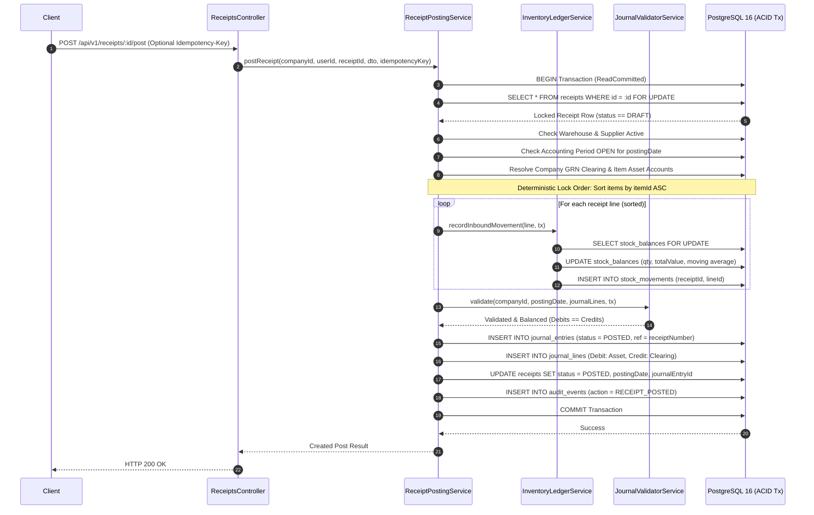
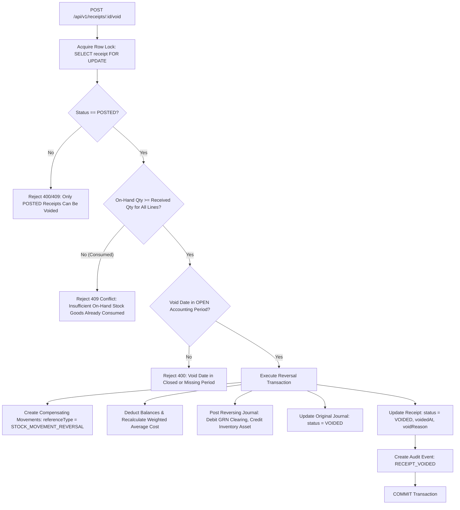

# Project Domain & Database Architecture Analysis

**Project**: Inventory Receipts with Costing and GL Posting  
**Phase**: Phase 05 — Inventory Ledger, Stock Balances & Weighted Average Costing  
**Author**: Principal / Senior Backend Engineer & Software Architect

---

## 1. Executive Summary & Problem Domain

The core responsibility of an Enterprise Resource Planning (ERP) procurement and inventory subsystem is ensuring that the physical intake of materials is synchronized with financial accounting records without discrepancy or latency.

In classic accounting, when goods arrive at a warehouse:

1. Physical goods are verified against delivery notes.
2. The inventory asset value increases on the balance sheet.
3. A matching financial accrual (Goods Received Not Invoiced / GR-IR) is recognized in the General Ledger.
4. Unit costs are updated across inventory valuation layers.

Phase 02 established the relational schema, foreign key constraints, indexes, and precision standards necessary to enforce these rules at the database engine level.

Phase 03 established the security perimeter, authentication foundation, role-based access control (RBAC), multi-tenant isolation barriers, and API hardening.

Phase 04 implements the complete backend API and domain invariants for managing **draft inventory receipts** and their line items prior to financial posting or stock ledger mutation.

---

## 2. Relational Schema Architecture



---

## 3. Entity-by-Entity Design Rationale

### 3.1 Tenant Root & Organization

- **`Company`**: Represents the tenant boundary. Every critical entity carries a `companyId` foreign key. Compound unique constraints (e.g. `[companyId, sku]`, `[companyId, code]`, `[companyId, receiptNumber]`) prevent cross-tenant key collisions while allowing independent numbering sequences per company.
- **`User`**: System actors with defined enterprise roles (`SUPER_ADMIN`, `ADMIN`, `ACCOUNTANT`, `WAREHOUSE_MANAGER`, `CLERK`). Scoped per company via `@@unique([companyId, email])`.
- **`Warehouse`**: Physical storage locations where stock balances reside.
- **`Supplier`**: External procurement counterparties.

### 3.2 Inventory & Valuation Masters

- **`Item`**: Defines cataloged stock units. Carries mandatory links to:
  - `assetAccountId`: The balance sheet asset account (e.g. `1200 Inventory`).
  - `cogsAccountId`: The income statement expense account (e.g. `5000 COGS`).
  - `expenseAccountId`: An optional variance/shrinkage account (e.g. `5100 Variance`).
  - `valuationMethod`: `MOVING_AVERAGE`, `FIFO`, or `STANDARD_COST`.
- **`StockBalance`**: Materialized view of current stock status per item and warehouse:
  - `quantityOnHand`: Total available physical stock.
  - `totalValue`: Total monetary value of on-hand inventory.
  - `averageCost`: Real-time unit cost ($\frac{\text{totalValue}}{\text{quantityOnHand}}$).
  - `version`: Integer sequence incremented on every balance mutation for **optimistic concurrency control**.
- **`StockMovement`**: Append-only transactional ledger documenting every stock addition or deduction. Never updated or deleted; provides 100% forensic auditability.

### 3.3 Receipt Transactions

- **`Receipt`**: Transaction header recording receipt metadata, warehouse, supplier, receiving clerk, and lifecycle state (`DRAFT`, `POSTED`, `CANCELLED`).
  - `journalEntryId`: Optional 1-to-1 unique foreign key linking the posted receipt directly to its General Ledger journal entry.
- **`ReceiptLine`**: Line items specifying `quantityReceived`, `unitCost`, and calculated monetary lines.
  - `onDelete: Cascade` is permitted only from `ReceiptLine` to `Receipt` (in draft state), but application-level state machine strictly forbids deleting posted receipts.

### 3.4 General Ledger & Double-Entry Bookkeeping

- **`Account`**: Chart of Accounts defining financial classifications (`ASSET`, `LIABILITY`, `EQUITY`, `REVENUE`, `EXPENSE`) and normal balances (`DEBIT`, `CREDIT`).
- **`AccountingPeriod`**: Represents monthly or annual accounting windows. Prevents posting into closed fiscal periods.
- **`JournalEntry`**: Double-entry journal transaction header. Enforces balanced postings.
- **`JournalLine`**: Individual debit and credit legs of a transaction.

### 3.5 Enterprise Resiliency & Audit

- **`AuditEvent`**: Tracks who modified what, when, and from what IP address.
- **`IdempotencyRecord`**: Stores incoming client idempotency keys to ensure network retries do not execute double receipt postings or double stock increments.
- **`OutboxEvent`**: Implements the Transactional Outbox pattern to safely coordinate events with external message buses without distributed two-phase commits.

---

## 4. Decimal Precision & Financial Arithmetic Decisions

Floating-point arithmetic (`FLOAT`, `DOUBLE PRECISION`) is strictly forbidden for financial and ERP systems due to binary rounding inaccuracies (e.g. $0.1 + 0.2 \neq 0.3$).

| Data Attribute                                              | PostgreSQL Data Type | Digits (Total, Scale)    | Rationale                                                                                                                                                                                                      |
| ----------------------------------------------------------- | -------------------- | ------------------------ | -------------------------------------------------------------------------------------------------------------------------------------------------------------------------------------------------------------- |
| **Currency Amounts** (`totalAmount`, `debit`, `credit`)     | `DECIMAL(19, 4)`     | 15 integer, 4 fractional | International accounting standard supporting micro-currencies and multi-decimal tax splits while preventing rounding drift.                                                                                    |
| **Unit Costs** (`unitCost`, `averageCost`, `standardCost`)  | `DECIMAL(19, 4)`     | 15 integer, 4 fractional | Moving average calculations frequently yield fractional cents (e.g. \$12.3456 per unit). Rounding to 2 decimals during intermediate receipt processing creates massive valuation drift across high quantities. |
| **Stock Quantities** (`quantityReceived`, `quantityOnHand`) | `DECIMAL(18, 4)`     | 14 integer, 4 fractional | Supports fractional units of measure (e.g. 1,250.7500 KG or 14.5000 Liters) without integer overflow.                                                                                                          |

---

## 5. Referential Integrity & Deletion Invariants

1. **Destructive Cascade Elimination**:
   - Deleting an `Account`, `Item`, `Warehouse`, or `Supplier` with existing transaction lines or balances is blocked via `onDelete: Restrict`.
   - Once a receipt transitions to `POSTED`, neither the receipt header, line items, nor the corresponding journal entries can be deleted. Corrections must take the form of reversing transactions.
2. **Compound Uniqueness for Multitenancy**:
   - Entities guarantee intra-tenant uniqueness:
     - `@@unique([companyId, code])`
     - `@@unique([companyId, sku])`
     - `@@unique([companyId, receiptNumber])`
     - `@@unique([companyId, entryNumber])`
     - `@@unique([companyId, warehouseId, itemId])`
3. **Index Strategy**:
   - High-cardinality search paths (e.g. `[companyId, status, receiptDate]`) are indexed to ensure sub-millisecond query execution even under millions of receipt records.

---

## 6. Phase 03 Security Architecture & Multi-Tenant Isolation

### 6.1 Authentication & Security Pipeline



### 6.2 Password Security & Cryptography

- **Algorithm**: **Argon2id** via `@node-rs/argon2`.
- **Enumeration Prevention**: Generic `HTTP 401: Invalid company, email, or password` message.
- **Dynamic Revalidation**: Verifies user existence, `user.isActive`, and `company.isActive` on every request.

---

## 7. Phase 04 Receipt Draft Management & Business Invariants

### 7.1 Receipt Lifecycle State Machine



### 7.2 Financial Calculation & Decimal Invariants

Receipt lines and header totals are never accepted from untrusted client input. The server enforces deterministic arithmetic via `DecimalMath` utilizing `Prisma.Decimal` and `ROUND_HALF_UP` rounding to 4 decimal places:

$$\text{Line Subtotal} = \text{round}_4(\text{quantityReceived} \times \text{unitCost})$$
$$\text{Line Total Amount} = \text{round}_4(\text{Line Subtotal} + \text{taxAmount})$$
$$\text{Receipt Subtotal} = \sum_{i=1}^n \text{Line Subtotal}_i$$
$$\text{Receipt Tax Amount} = \sum_{i=1}^n \text{taxAmount}_i$$
$$\text{Receipt Total Amount} = \text{Receipt Subtotal} + \text{Receipt Tax Amount}$$

### 7.3 Multi-Tenant Boundary Enforcement for Inventory Receipts

1. **Entity Ownership Verification**: Before creating or modifying a receipt, `ReceiptsService` validates that the warehouse, supplier, and all line item IDs exist, belong to `user.companyId`, and have `isActive === true`. Attempting to reference entities from another company is rejected with `HTTP 400 Bad Request`.
2. **IDOR & Scoped Access**: Any attempt to retrieve, update, or delete a receipt belonging to another tenant is blocked with `HTTP 403 Forbidden` (`Cross-company access denied`).
3. **Sequential Line Numbering**: Line numbers (`lineNumber`) are maintained sequentially ($1, 2, \dots, n$) without gaps during line additions, deletions, or reconciliations.
4. **Draft-Only Mutation Invariant**: Once a receipt transitions out of `DRAFT` status (`POSTED` or `CANCELLED`), updates and deletions are strictly blocked with `HTTP 400 Bad Request` or `HTTP 409 Conflict`.

---

## 8. Phase 05 Inventory Ledger, Stock Balances & Weighted Average Costing

### 8.1 Moving Weighted-Average Costing Engine

Inventory valuation in this system is governed by a perpetual moving weighted-average costing policy maintained per discrete tuple `[companyId, warehouseId, itemId]`.

#### Inbound Intake Mathematical Formulation

When incoming stock of quantity $Q_{\text{in}}$ at unit cost $C_{\text{in}}$ is received against an existing stock balance with quantity $Q_{\text{prev}}$ and total value $V_{\text{prev}}$:

$$\text{Incoming Value} = \text{round}_4(Q_{\text{in}} \times C_{\text{in}})$$
$$Q_{\text{new}} = Q_{\text{prev}} + Q_{\text{in}}$$
$$V_{\text{new}} = V_{\text{prev}} + \text{Incoming Value}$$

$$ C_{\text{new}} = \begin{cases}
C_{\text{in}}, & \text{if } Q_{\text{prev}} \le 0 \\
\text{round}_4\left(\frac{V_{\text{new}}}{Q_{\text{new}}}\right), & \text{if } Q_{\text{prev}} > 0
\end{cases}$$

#### Outbound Relieving & Zero Residual Penny Invariant
When stock is issued or relieved ($Q_{\text{out}}$):
1. **Relieving Rate**: Relieved strictly at current moving average cost $C_{\text{avg}} = \text{current averageCost}$.
2. **Relieved Value**: $V_{\text{out}} = \text{round}_4(Q_{\text{out}} \times C_{\text{avg}})$.
3. **Depletion Zeroing Rule**: In standard decimal arithmetic, successive issues with fractional unit costs can leave fractional pennies (e.g. $\$0.0001$) on balance sheets when on-hand quantity drops to zero. To ensure complete financial integrity, the costing engine enforces:
$$Q_{\text{new}} = Q_{\text{prev}} - Q_{\text{out}}$$
$$\text{If } Q_{\text{new}} = 0 \implies V_{\text{new}} = 0.0000 \text{ and } C_{\text{new}} = 0.0000$$
4. **Insufficient Stock Defense**: If $Q_{\text{out}} > Q_{\text{prev}}$, the transaction is rejected immediately with `InsufficientStockException` (HTTP 400 Bad Request), preventing negative physical stock.

### 8.2 Database Concurrency & Race-Condition Architecture



#### The Initial-Balance Race Condition Fix
In concurrent systems, standard `SELECT ... FOR UPDATE` returns an empty set if the row does not yet exist. If two concurrent transactions attempt to intake the very first item for a warehouse simultaneously, both would see no row, proceed to insert new rows, and one would crash with a unique constraint violation or overwrite the other's balance.

This is solved permanently using PostgreSQL atomic upsert:
```sql
INSERT INTO "stock_balances" ("id", "companyId", "warehouseId", "itemId", "quantityOnHand", "totalValue", "averageCost", "version", "createdAt", "updatedAt")
VALUES (gen_random_uuid()::text, $1, $2, $3, 0, 0, 0, 0, NOW(), NOW())
ON CONFLICT ("companyId", "warehouseId", "itemId") DO NOTHING;
```
Immediately followed by:
```sql
SELECT * FROM "stock_balances"
WHERE "companyId" = $1 AND "warehouseId" = $2 AND "itemId" = $3
FOR UPDATE;
```
This guarantees the row exists and is exclusively held by the transaction before reading balances or computing moving averages.

#### Deterministic Deadlock Prevention
When multiple items are processed in a single batch, item keys are locked in strict ascending alphanumeric order by `itemId: 'asc'` to eliminate circular wait lock chains.

#### Transient Failure Retry Strategy
PostgreSQL serialization conflicts (`40001`), deadlocks (`40P01`), and Prisma write conflicts (`P2034`) are caught by `withRetry` using bounded exponential backoff with random jitter (up to 3 retries, initial delay 50ms, max delay 500ms).

### 8.3 Stock Movement Ledger & Compensating Reversals

1. **Append-Only Immutability**: `StockMovement` records are never updated or deleted.
2. **Compensating Reversal Policy**:
   - Reversing a movement (`reverseMovement`) creates a new compensating movement with `referenceType = 'STOCK_MOVEMENT_REVERSAL'` and `referenceId = originalMovementId`.
   - Inbound reversals relieve stock at the original movement's cost (verifying sufficient stock exists first).
   - Outbound reversals restore stock and recompute moving weighted average cost.
   - Duplicate reversals on the same original movement are blocked with `ConflictException` (HTTP 409).

### 8.4 Real-Time Balance Reconciliation Engine

The system provides an automated audit endpoint `GET /api/v1/inventory/reconcile/:warehouseId/:itemId`:
- Calculates the sum of all inbound and outbound quantities and values across `StockMovement` records.
- Compares these mathematical sums against the materialized `StockBalance` row.
- Returns `{ inSync: boolean, deltaQuantity: string, deltaTotalValue: string, balanceSnapshot, calculatedLedger }`.
- Enables automated financial integrity audits without locking ledger tables.

---

## 9. Phase 06 Accounting Foundation, Chart of Accounts & Accounting Periods

### 9.1 Chart of Accounts & Tree Hierarchy

The Chart of Accounts model supports hierarchical structures via a self-referencing relationship:
- `Account.parentId String?` references `Account.id` (`parent` / `children` relations with `onDelete: Restrict`).
- **Cycle Detection**: When updating an account's parent, the service traces the ancestor chain to ensure an account cannot become a descendant of itself, preventing infinite loops.
- **Self-Parenting Prevention**: An account cannot set its own `id` as `parentId`.
- **Referential Protection**: Deletion of an account is blocked (`HTTP 409 Conflict`) if it has:
  1. Child sub-accounts.
  2. Associated journal entry lines.
  3. Linked items using it as an inventory asset account (`Item.assetAccountId`).
  4. Company-level configuration using it as the GRN clearing account (`Company.grnClearingAccountId`).

### 9.2 Accounting Periods & Transaction Windows

Accounting periods partition financial transactions into discrete fiscal intervals (e.g. FY2026-M01):
- **Inclusive Boundaries**: Transactions are valid if `period.startDate <= transactionDate <= period.endDate`.
- **Tenant-Scoped Overlap Prevention**: No two periods within the same company may overlap. A query checks existing ranges:
  $$\max(\text{start}_A, \text{start}_B) \le \min(\text{end}_A, \text{end}_B)$$
  Any collision is rejected with `HTTP 409 Conflict`.
- **Lifecycle Control**: Periods transition between `OPEN` and `CLOSED`.
- **Posting Guard**: The helper `getEligibleOpenPeriod(companyId, date, tx)` looks up the open period covering a transaction date. If the period is closed, missing, or outside the date window, posting is rejected with `HTTP 400 Bad Request`.

### 9.3 Inventory Accounts Resolution Architecture

Preparing for receipt posting in Phase 07 requires unambiguous resolution of accounting destinations:
1. **GRN Clearing Account (Accrued Liabilities)**:
   - Configured via `Company.grnClearingAccountId`.
   - Must belong to the same company, be active (`isActive = true`), and possess classification `LIABILITY`.
2. **Inventory Asset Account**:
   - Configured per SKU via `Item.assetAccountId`.
   - Must belong to the same company, be active (`isActive = true`), and possess classification `ASSET`.
3. **Reusable Resolver**:
   - `resolveReceiptAccounts(companyId, itemIds, tx)` fetches both the company clearing account and all SKU asset accounts in an atomic, cached database operation, returning a strongly-typed map ready for double-entry journal creation.

### 9.4 Pure Double-Entry Validation Engine (`JournalValidatorService`)

The general ledger integrity engine enforces double-entry invariants before persisting any financial record:



- **Mathematical Invariant**:
  $$\sum_{i=1}^{n} \text{Debit}_i = \sum_{i=1}^{n} \text{Credit}_i$$
  Calculated with `Prisma.Decimal` using 4-decimal precision (`ROUND_HALF_UP`).
- **Validation-Only Endpoint**: `POST /api/v1/journal-entries/validate` runs this entire pipeline without modifying database state, enabling interactive UI balance verification before submission.

---

## 10. Phase 07 Atomic Receipt Posting, Inventory Integration & Safe Void Workflow

### 10.1 The Atomic Posting Transaction Boundary

Receipt posting is the central financial and physical integration boundary of the ERP. A single PostgreSQL ACID database transaction coordinates all mutations across the inventory sub-ledger and general ledger:



### 10.2 Concurrency, Deadlock Prevention & Idempotency

1. **Row-Level Concurrency Protection**:
   `SELECT ... FOR UPDATE` acquires an exclusive row lock on the target receipt inside the transaction. A concurrent attempt to post the same receipt waits on the lock, reads `status === 'POSTED'`, and is safely rejected with `HTTP 409 Conflict`.
2. **Deterministic Multi-Row Lock Order**:
   Receipt lines are sorted by `itemId: 'asc'` prior to executing stock balance updates. If two concurrent receipts attempt to post items $\{A, B\}$ simultaneously, both acquire locks in alphabetical order ($A \to B$), completely eliminating circular wait deadlocks.
3. **Transient Retry Policy**:
   PostgreSQL serialization conflicts (`40001`), deadlocks (`40P01`), and Prisma write conflicts (`P2034`) are intercepted by `withRetry`, which retries with bounded exponential backoff and random jitter (up to 3 attempts).
4. **Idempotency Guarantees**:
   The `Idempotency-Key` header is checked against `idempotency_records`. Replayed requests return cached responses immediately without creating duplicate movements or journals. Concurrent requests with the same key are safely deduplicated.

### 10.3 Safe Void & Reversal Workflow

Voiding a posted receipt is an audited financial reversal that restores balances without mutating original historical records:



- **Stock Depletion Defense**: If goods received on a receipt were subsequently issued, shipped, or consumed, voiding the receipt would drive physical stock below zero and corrupt financial valuation. The system strictly checks $Q_{\text{onhand}} \ge Q_{\text{received}}$ for every line. If violated, voiding is blocked with `HTTP 409 Conflict`.
- **Append-Only Immutability**: Original stock movements and journal entries remain untouched. Compensating movements and reversing journal entries are posted, maintaining a pristine, auditable transaction ledger.
$$
